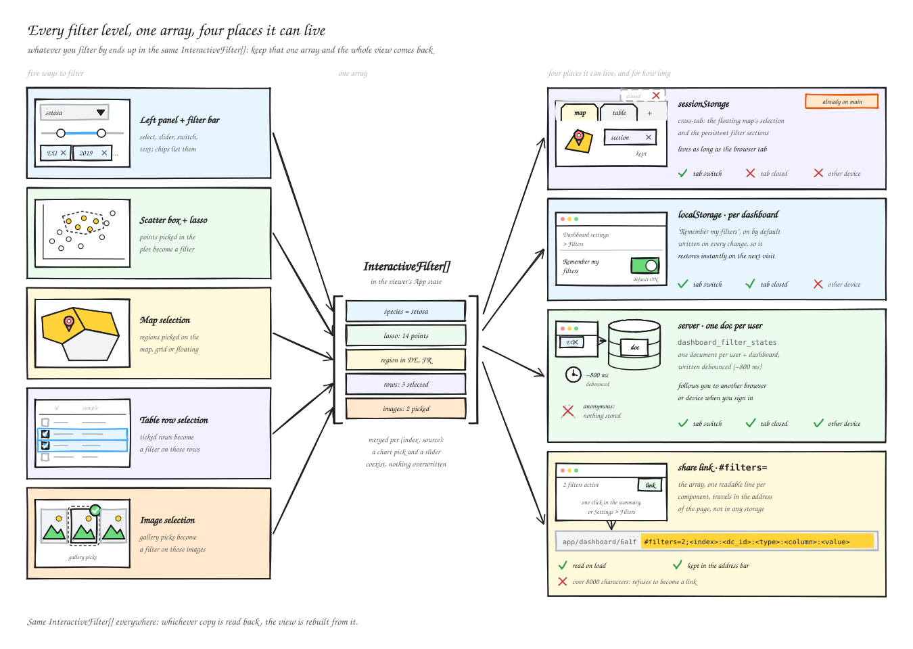
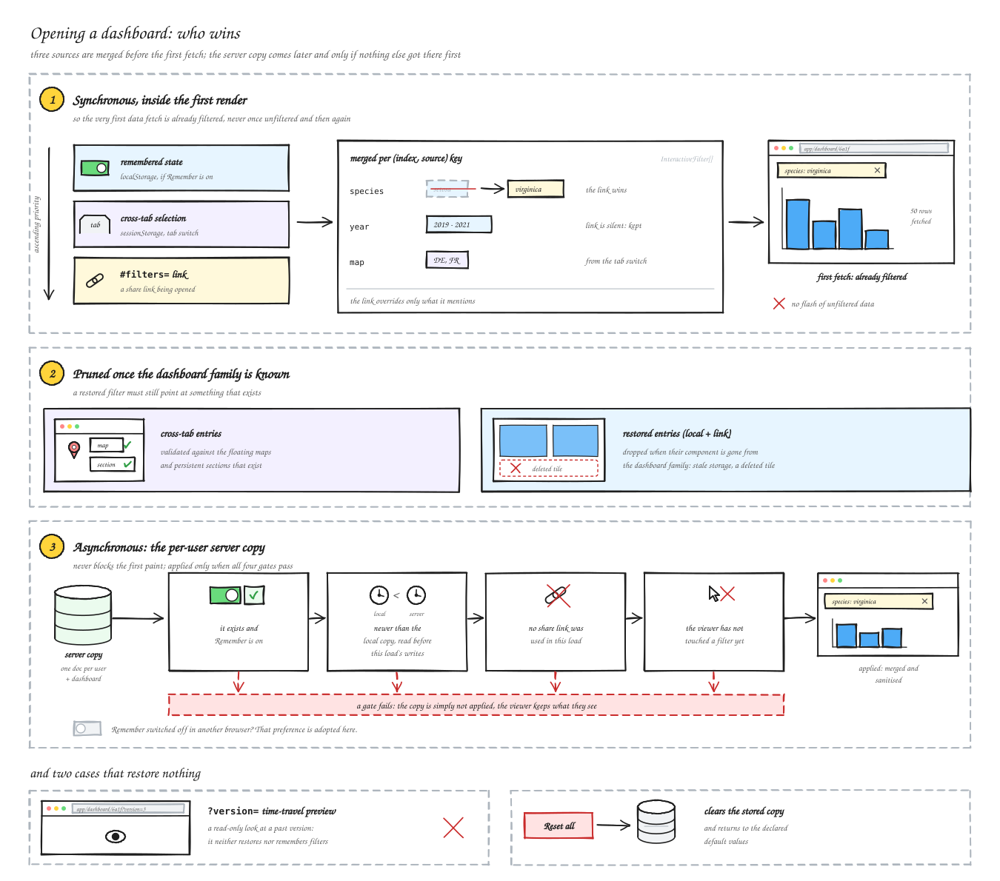

# <span style="color: #F68B33;">:material-view-dashboard:</span> Using a dashboard

[](../../images/guides/web-ui/look_paper_light.webp){target=_blank}
[](../../images/guides/web-ui/look_paper_dark.webp){target=_blank}

A dashboard opens in view mode, where you filter, read and comment. Its owner switches to edit mode to change it. Labels below are those of the default Paper look, with **Search**, **Comments**, **Analysis** and **Edit** in the dock; the Classic look has the same buttons in its header. See [Paper and Classic](web_ui.md#looks). For what each part does in depth, see [Layout, tabs and sharing](../../features/dashboards.md).

## As a viewer

### Move around { #move-around }

- **Tabs** sit in the sidebar, folded to an icon rail while the filter panel is open.
- **Search** (**⌘K** / **Ctrl+K**) finds a component on any tab. See [Spotlight search](spotlight-search.md).
- The **Guide**, when the author turned it on, walks you through the dashboard. See [The dashboard Guide](dashboard-guide.md).

### Filter { #working-with-the-filter-panel-v140 }

[{ width="800" }](../../images/guides/dashboard-usage/viewer_filters_light.webp){target=_blank}
[{ width="800" }](../../images/guides/dashboard-usage/viewer_filters_dark.webp){target=_blank}

- The **filter panel** holds the dashboard's filters in foldable sections. Collapse it to a rail that still counts the active filters, or resize it by its edge; both are remembered across tabs.
- The summary above the controls lists each active filter, with a clear button per row. **Reset** clears every filter on this tab.
- A section with a pin is shared by every tab and keeps its values when you switch. See [Sections on every tab](../../features/dashboards.md#persistent-sections).
- Selecting points on a scatter plot, rows in a table or an area on a map filters the other components too. **Reset selection** on the tile clears it. See [Selection filtering](../../features/interactive-selection-filtering.md).

### Use the map panel { #the-map-panel-v140 }

[{ width="800" }](../../images/landing/map_light.webp){target=_blank}
[{ width="800" }](../../images/landing/map_dark.webp){target=_blank}

A map authored as a dashboard-wide panel follows you across tabs. Its header control docks, floats or hides it. Lasso, box or click on it to filter every tab, and open the rows behind it from its header.

### Read a tile { #read-a-tile }

[](../../images/guides/dashboard-guide/tile_info_popover_light.webp){target=_blank}
[](../../images/guides/dashboard-guide/tile_info_popover_dark.webp){target=_blank}

Hover a tile for its actions:

- :material-information-outline: **About this component**: what it shows and how to read it, as its author wrote it. A tile with a title has it beside the title.
- :material-format-list-bulleted: **Data source and settings**: its type, data source and configuration, with the code to copy.
- **Toggle fullscreen**, **Download CSV** on a table, **Inspect**, and **Export / embed** to put the tile on another website (see [Export and embedding](../../features/component-export.md)).

[](../../images/guides/dashboard-guide/tile_data_source_popover_light.webp){target=_blank}
[](../../images/guides/dashboard-guide/tile_data_source_popover_dark.webp){target=_blank}

### Wait for a large dashboard { #how-a-dashboard-loads-v130 }

[](../../images/react/load_all_light.webp){target=_blank}
[](../../images/react/load_all_dark.webp){target=_blank}

Tiles load as they scroll into view, and a ring with a count such as `6/8` beside the title tracks those on screen. Large collections arrive reduced, and say so:

- A figure shows a badge such as `9,900 / 12,011,000 pts`. :material-database-arrow-down: **Load all** fetches every point.
- A table pages its rows. Past about a million rows, sorting is off.
- An advanced visualization computed from a sample carries an orange **estimated** badge.

See [Performance & Scaling](../../features/performance.md) for the thresholds.

### Discuss and compare { #discuss-and-compare }

| Button | What it does | More |
|--------|--------------|------|
| **Comments** | Threads on a tile or a tab, and annotations drawn on charts, tables and maps | [Comments and annotations](../../features/comments-annotations.md) |
| **Analysis** | Save selections as groups, then colour or split every figure by them | [Selection groups](../../features/interactive-selection-filtering.md#selection-groups) |
| **Metadata** | The sample table beside the dashboard, with your own label columns | [Metadata panel](../../features/metadata-panel.md) |

From a project's **Runs** tab, **Compare** opens a dashboard with one run's changes marked. See [Runs and run comparison](../../features/runs.md).

### Catch up on what changed { #whats-new }

The **What's new** key in the header counts the changes since your last visit: new data, edited components, new comments. Its panel shows them on the figures with **Off**, **Overlay** or **Split**, and **Before | Now** draws one tile as it was and as it is. The **Notifications** bell lists every dashboard and project that changed. See [What's new](../../features/whats-new.md).

### Keep your filters { #remembered-filters }

[{ width="780" }](../../images/guides/filter-persistence/restored_light.webp){target=_blank}
[{ width="780" }](../../images/guides/filter-persistence/restored_dark.webp){target=_blank}

A dashboard reopens on the filters you left, in any browser you sign in to: panel filters, chart and map selections, table rows. **Settings → Filters → Remember my filters** turns this off for one dashboard. Anonymous visitors keep their filters in this browser only. **Reset** also clears what is remembered.

### Share a filtered view { #filter-links }

[{ width="680" }](../../images/guides/filter-persistence/settings_light.webp){target=_blank}
[{ width="680" }](../../images/guides/filter-persistence/settings_dark.webp){target=_blank}

The address bar carries the view as `#filters=…`. Copy it from there, from the link icon beside **N filters active**, or with the copy button of **Share this view** in **Settings → Filters**. Opening such a link applies its filters on top of yours.

??? info "Which filters win when a dashboard opens"
    Three sources merge, each overriding the one before: the remembered filters, the
    selections carried across tabs, then the link. A `?version=` preview neither restores
    nor remembers anything.

    [](../../images/guides/filter-persistence/schema_one_array.svg){target=_blank}
    [](../../images/guides/filter-persistence/schema_mount_merge.svg){target=_blank}

### Change your view and settings { #dashboard-settings-drawer }

**Settings** opens **Dashboard settings**, a dialog with a rail of sections. Changes save as you make them.

| Section | Shown | What it holds |
|---------|-------|---------------|
| **About this dashboard** | Always | Project, template, owner and visibility, the **Run parameters**, **View ingestion report** and the IDs under **Identifiers** |
| **Your view** | Always | **Font size** (85% to 130%) and **Page width** (Full, Wide, Comfortable, Compact), for you, in this browser |
| **Filters** | View mode | **Remember my filters** and the filter link |
| **Tab defaults**, **Tiles**, **Filtering**, **Guide** | Edit mode | Saved with the dashboard. See [Settings for everyone](#settings-for-everyone) |
| **Branding** | Edit mode | Logo, colours and figure palette. See [Brand the dashboard](#appearance) |
| **History** | Edit mode | Every saved version, to preview, restore or bookmark. See [History](../../features/versioning.md#history) |
| **Data version** | Edit mode | The dashboard drawn from earlier data, for you only, until you reload. See [Data versions](../../features/versioning.md#data-versions) |
| **Feedback** | With a [feedback link](../../installation/env-reference.md#feedback) | Report a problem or suggest an improvement |

## As an editor

### Edit and save { #saving }

[{ width="600" }](../../images/guides/dashboard-usage/save_notification_light.webp){target=_blank}
[{ width="600" }](../../images/guides/dashboard-usage/save_notification_dark.webp){target=_blank}

- **Edit** opens the editor on a dashboard you own. On someone else's, its tooltip suggests duplicating it to get your own copy.
- **Add → Component** opens the builder and **Add → Section** adds a section. See [Dashboard creation](dashboard_creation.md).
- Changes save on their own about half a second after you stop. **Save** writes at once and refreshes the dashboard's thumbnail.
- Each save is a version: automatic saves fold into one per 5 minutes of editing, and **Save** always records its own. See [Versions and history](../../features/versioning.md).
- **Exit Edit** returns to view mode.

### Arrange tiles { #arrange-tiles }

[{ width="235" }](../../images/guides/dashboard-guide/tile_toolbar_icons_light.webp){target=_blank}
[{ width="235" }](../../images/guides/dashboard-guide/tile_toolbar_icons_dark.webp){target=_blank}

Move a tile by :material-dots-grid: **Drag to move**, and resize it by its edges and corners. Its :material-dots-vertical: menu holds:

| Item | What it does |
|------|--------------|
| **Edit** | Reopens the builder on this tile |
| **History** | The tile across saved versions, to compare or restore it alone. See [Component history](../../features/versioning.md#component-history) |
| **Duplicate**, **Move to section**, **Delete** | What they say |
| **Copy to tab…** | Adds a copy to another tab. See [Copy to tab](../../features/dashboards.md#copy-to-tab) |
| **Highlight on…** | Shows a figure on another tab without copying it. See [Highlight components](../../features/components.md#highlight-components) |
| **Font size** | A figure's own font scale, 0.7× to 2× |
| **Reset to auto height** | On a tile resized by hand that could fit its content |

### Describe a tile { #describe-a-tile }

A component's `description` fills the subtitle under its title and **About this component**. The first paragraph is the lead; a paragraph that opens with `How to read:`, `Annotations:`, `Note:`, `Warning:` or `Source:` becomes a block, a callout or the footer.

```yaml
description: |
  Which lineages make up the community? Each dot is one phylum.

  How to read: a large dot is a dominant phylum.

  Note: with more than 3,000 ASVs, the tree keeps the 3,000 most abundant.
```

### Settings for everyone { #settings-for-everyone }

[{ width="680" }](../../images/guides/dashboard-usage/settings_tab_defaults_light.webp){target=_blank}
[{ width="680" }](../../images/guides/dashboard-usage/settings_tab_defaults_dark.webp){target=_blank}

In edit mode, these sections of **Settings** are saved with the dashboard for every reader:

| Section | What it holds |
|---------|---------------|
| **Tab defaults** | What this tab opens with: page width, filter panel open or collapsed, **Show the tab's name**. A reader's own choice wins. See [Tab defaults](../../features/dashboards.md#tab-defaults) |
| **Tiles** | **Fit tiles to their content**, and **Advanced viz controls** as *Popover*, *Under title* or *Side rail*. See [Tile height](../../features/yaml-sync.md#tile-height) |
| **Filtering** | **Funnel filtering by default** |
| **Guide** | **Show the Guide** and its **Introduction**. See [The dashboard Guide](dashboard-guide.md) |

### Brand the dashboard { #appearance }

[{ width="680" }](../../images/guides/dashboard-usage/settings_branding_light.webp){target=_blank}
[{ width="680" }](../../images/guides/dashboard-usage/settings_branding_dark.webp){target=_blank}

**Settings → Branding → Customise** gives this dashboard its own logo, colours, fonts and figure palette inside the instance's brand. Fields left empty follow the instance, and a child tab follows its main tab (**Inherit main tab**). A **Preview** renders real components in light and dark.

An uploaded logo stays on this instance and is left out of YAML exports; use `logo_url` for one that has to travel. See [Branding](../administration/branding.md).
