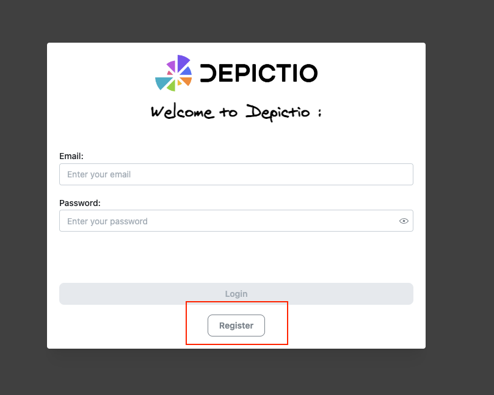
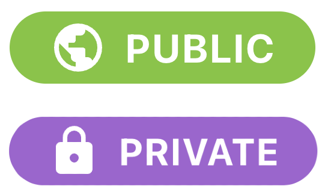

# :material-web: Web UI

## :material-palette-swatch-outline: Paper and Classic <small>(v1.17.0+)</small> { #looks }

Depictio comes in two looks, with the same pages, panels and settings:

- **Paper**, the default since v1.17.0: every page on paper panels, a top bar with the
  page or dashboard title, and a sidebar. On a dashboard, the tab sidebar folds to an icon
  rail, by itself while the filter panel is open, and a floating **dock** holds Search,
  Analysis, Comments and Edit / Save / Exit as icon keys. Drag it by its grip, or use the
  arrow keys, to the bottom, left, right or top of the page; the browser keeps the place.
- **Classic**, the layout of earlier versions: a header bar of buttons and a tab sidebar.

=== "Paper"

    {target=_blank}
    {target=_blank}

=== "Classic"

    {target=_blank}
    {target=_blank}

A page takes the first of:

1. `?chrome=glass` (Paper) or `?chrome=base` (Classic) in its URL, kept for the rest of
   the browser session, for support and testing;
2. your own pick, in [**Account settings → Preferences → Look**](#account-settings), kept
   in this browser;
3. the default an administrator sets in
   [**Administration → Branding → Default look**](../administration/branding.md#default-look);
4. Paper.

Screenshots in these docs show one look or the other; where a control sits in the header
in Classic, Paper has it in the top bar or the dock.

## :material-account-plus: Register and login

### :material-account-plus: Registering an Account (Sign Up)

1. **Navigate to the Registration page** by clicking the **Register** button on the login screen.

    

2. **Enter your email address** in the "Email" field.

3. **Create a password** and enter it in the "Password" field. You can click the eye icon to view the password as you type and **Confirm your password** by re-entering it in the "Confirm Password" field.

4. Click the **Register** button to submit your registration details.

5. After successful registration, you can return to the login page by clicking the **Back to Login** button.

### :material-login: Logging In (Sign In)

1. **Open the Depictio Login page**.
2. **Enter your email address** in the "Email" field.
3. **Enter your password** in the "Password" field.
4. If you want to see the password as you type it, click the eye icon next to the password field.
5. Once both fields are filled in, click the **Login** button.
6. You will be redirected to the Depictio landing page (currently `/dashboards`).

### :material-google: Google OAuth Login

If you have configured Google OAuth for your Depictio instance (see [Configuration](../../../installation/configuration/#google-oauth-integration)), you can log in using your Google account. If the account does not exist, it will be created automatically.

When the server refuses the sign-in, for example because registration is closed, the
callback page shows **Sign-in failed** and the reason, since v1.17.2.

### :material-shield-key-outline: SSO login <small>(v1.18.0+)</small>

An instance with [SAML single sign-on](../../installation/sso.md) adds a button, *Sign in
with SSO* or the label it sets, that sends you to your institution's identity provider and
back.

## :material-view-dashboard: Landing page / Dashboards section (/dashboards) { #dashboards-listing }

{target=_blank}
{target=_blank}

The listing opens on the **Table** view <small>(v1.12.0+)</small>, one row per dashboard. In the
**Thumbnails** view each dashboard is shown as a card. Cards display the dashboard's screenshot thumbnail
once one has been captured, and fall back to the dashboard's logo (when set) before the
generic placeholder.

The table view has a **Last viewed** column <small>(v1.11.0+)</small>, sorted newest
first, with dashboards you never opened last. It is kept per browser.

The **Table display** menu <small>(v1.17.0+)</small> sets the row height, **Comfortable**
or **Compact**, and which columns show, with **Show all** and **Reset**. The Projects
listing has the same menu. On a narrow screen the actions column stays pinned to the
right edge while the table scrolls <small>(v1.17.3+)</small>.

Dashboards are grouped into sections, each dashboard in one only, in this order:
**nf-core dashboards**, **Demo dashboards**, **Public**, **Accessed** and **Owned**.
Since v1.17.2 the nf-core section holds every dashboard of an nf-core workflow, the
imported templates included: the seeded ones first, then the others by title.

#### :material-view-grid-outline: Thumbnails or table <small>(v1.11.2+)</small> { #listing-views }

The view switcher in the toolbar picks between **Thumbnails**, the card grid, and
**Table**, with sortable columns and bulk selection. The Tiles view of earlier
versions is gone, and a browser that had it opens on Thumbnails.

In Thumbnails, the **Card display** menu beside the switcher sets:

- **Cards per row**: 5 by default since v1.12.0, or 2 to 6, or Auto. Auto never makes
  more columns than a section has cards, so a section with a single dashboard draws
  it across the whole width.
- **Badges**: which of Project, Template, Owner, Visibility, Last modified and Tabs a
  card shows. Hovering a badge gives its long form.

**Reset to defaults** restores both, so five cards per row. They are layout preferences,
kept in the browser and left out of shared links. A browser that opened the listing
before v1.12.0 stored Auto, the former default, and keeps it until you pick another
value or reset. Resting the pointer on a thumbnail opens a larger,
sharper preview.

Someone who never picked a view gets the one the deployment sets with
[`DEPICTIO_VIEWER_DASHBOARDS_DEFAULT_VIEW`](../../installation/env-reference.md#react-viewer-frontend):
**Table** since v1.12.0, Thumbnails before. Set it to `thumbnails` to open the grid
again. A view picked in the browser, or named by a shared link such as
`/dashboards?view=thumbnails`, wins over it.

### :material-menu: Sidebar Navigation

The left sidebar provides easy access to various sections of the application. This includes:

- :material-view-dashboard: **Dashboards**: View and manage your dashboards.
- :material-folder-multiple: **Projects**: Manage your projects and data collections.
- :material-shield-account: **Administration** (sysadmin users only): Access administrative features (only available to users with admin privileges).
- :material-information: **About**: Information about the application and its repository.

The button at the top of the sidebar folds it to icons. The top bar holds the theme
toggle and your avatar, which opens [Account settings](#account-settings) <small>(v1.17.0+)</small>.
The compass in the header of the Dashboards and Projects pages starts the guided tour.

#### :material-server-outline: Server information <small>(v1.17.0+)</small> { #server-information }

The server status at the foot of the sidebar, **Online** with the server version, opens
the server information: version, API, mode, and links to the documentation, GitHub, the
releases and the issue tracker. On a dashboard it sits at the foot of the tab rail, and
in Classic it is the version badge.

{target=_blank}
{target=_blank}

For administrators, its last line says whether a newer Depictio release is out. When one
is, a dot marks the status and a card in the popover names the release; **OK** hides it
until the next one. See [Release check](#release-check).

### :material-plus-circle: Creating a New Dashboard

1. On the **landing page**, click the orange **"+ New Dashboard"** button located in the top right corner.
2. A pop-up window will appear with a field labeled **"Dashboard Title"**.
3. **Enter a name** for your new dashboard.
4. Your dashboard will be created with the title you provided and added to the section.
5. Click the blue **"Create Dashboard"** button to create the dashboard.
6. The new dashboard will appear in the section with informations including name, owner and status (public/private).

### :material-cog: Functionalities

#### :material-eye: Viewing a Dashboard

1. Once a dashboard is created, it will appear under the section.
2. Click the **"View"** button next to the dashboard name to open and explore its content.

#### :material-delete: Deleting a Dashboard

1. To delete a dashboard, locate the dashboard in the section.
2. Click the red **"Delete"** button next to the dashboard name.
3. A confirmation pop-up will appear, asking **"Are you sure you want to delete this dashboard?"**.
4. Click **"Delete"** to permanently remove the dashboard, or **"Cancel"** to keep it.

#### :material-pencil: Editing dashboard name

1. To edit the name of a dashboard, locate the dashboard in the section.
2. Click the **"Edit name"** button next to the dashboard name.
3. A pop-up window will appear with a field labeled **"New name"**.
4. **Enter a new name** for your dashboard.
5. Click the blue **"Save"** button to save the new name.

#### :material-content-copy: Duplicating a dashboard

1. To duplicate a dashboard, locate the dashboard in the section.
2. Click the **"Duplicate"** button next to the dashboard name.
3. The dashboard will be duplicated and added to the section with the suffix **"(copy)"**.

!!! note
    

    
    

    Both "public" and "private" dashboards are listed in the **Dashboards** section. Public dashboards are accessible to all users, while private dashboards are only visible to the user who created them.
    Only the user who created a private dashboard can edit, or delete it.

#### :material-link-variant: Share a filtered listing <small>(v1.10.1+)</small> { #share-a-filtered-listing }

The filters of `/dashboards` and `/projects` are kept in the URL. Set them, then
press the link button in the toolbar to copy a link to that view:

| Link | Shows |
| --- | --- |
| `/dashboards?template=nf-core/rnaseq` | Dashboards built from nf-core/rnaseq, any version |
| `/projects?template=nf-core/rnaseq,nf-core/viralrecon` | Projects built from either pipeline |

Whoever opens it sees a **Shared view** banner, with **Show everything** to clear the
filters. The link grants no access: it only narrows what they could already open.

## :material-folder-multiple: Projects section (/projects)

!!! info "Complete Projects Documentation"
    **For comprehensive information about Projects in Depictio, see the dedicated [Projects Guide](../projects/guide.md).**

    The Projects Guide covers:

    - **Project Types** - Basic vs Advanced projects
    - **Creating Projects** - Step-by-step instructions
    - **Configuration** - YAML setup and examples
    - **Data Collections** - File organization and processing
    - **Permissions** - Access control and collaboration
    - **Best Practices** - Optimization and troubleshooting

    **Quick Links:**

    - :material-folder-multiple: **[Projects Guide](../projects/guide.md)** - Complete project management
    - :material-code-braces: **[YAML Examples](../projects/yaml-examples.md)** - Configuration patterns
    - :material-file-document: **[Configuration Reference](../projects/reference.md)** - Full parameter reference

### :material-information: Quick Overview

- The left sidebar includes a **"Projects"** section where users can manage their projects
- Click on **"Projects"** to navigate and view them
- Projects organize your data and provide structure for dashboards
- You can access workflows and data collections recursively within each project
- Each entity allows you to view configuration details and preview data

### :material-link-variant: Creating a project from a run folder or a manifest <small>(v1.16.0+)</small> { #creating-a-project-from-a-manifest }

**+ New Project** offers four tabs: **Create New**, **Import**, **From
Manifest** and **From a run folder**. The last two build a project from data
the server reads, with no CLI involved, in three steps: **Source**, **Preview**
(a dry run, nothing is created) and **Create**.

- **From a run folder**: point at the results folder of one pipeline run, in a
  bucket or, on a `depictio local` server, on this computer. Depictio
  recognises the pipeline, picks the template and shows what each data
  collection finds there; the data is ingested in the background. See
  [From a run folder](../projects/remote-data.md#from-a-run-folder).
- **From Manifest**: paste the URL of a
  [data manifest](../projects/remote-data.md#the-data-manifest-contract) and
  pick a template that reads one. See
  [From a manifest](../projects/remote-data.md#creating-a-project-from-a-manifest).

## :material-account: Account settings (/profile) <small>(v1.17.0+)</small> { #account-settings }

Your avatar in the top bar opens **Account settings**, one page of sections that open
and close:

- **Account**: your email, role and dates. Click the avatar to upload a profile
  picture; the server stores it as a 256-pixel WebP and includes it in
  [backups](../administration/backup.md). Signing in with Google sets your Google picture
  until you upload one.
  Since v1.18.0 it shows your [group](../administration/groups.md#my-groups) badges
  (crown for P.I., shield for group admin), which open `/groups`, and the name and title
  your identity provider gives.
- **Password**: change the password you sign in with.
- **CLI agents**: the long-lived tokens of the `depictio` command line, see
  [Create a CLI configuration](../get_started.md#create-a-cli-configuration). The former
  `/cli-agents` page leads here.
- **Preferences**, kept in this browser: **Theme**, light or dark; [**Look**](#looks),
  Paper, Classic or the instance default; **Font size** of figures, tables and cards.
- **Getting started**: replay the guided tour of the app or of the builder.
- **Server**: the [server information](#server-information).

**Sign out** is at the foot of the page.

=== "Account"

    {target=_blank}
    {target=_blank}

=== "Preferences"

    {target=_blank}
    {target=_blank}

## :material-information: About section (/about)

{target=_blank}
{target=_blank}

The **About** section provides information about the GitHub repository and the documentation.

## :material-shield-account: Admin section (/admin) { #admin-section }

{target=_blank}
{target=_blank}

The **Admin** section is only accessible to users with admin privileges. Since v1.17.0
its pages are listed down the side, in four groups:

| Group | Pages |
|-------|-------|
| **People** | **Users**: every account, its role (standard or system admin), deletion and, since v1.19.0, [Add user](#add-a-user). **Groups** <small>(v1.18.0+)</small>: see [Groups](../administration/groups.md#managing-a-group) |
| **Content** | **Projects** and **Dashboards**: every one of them, whoever owns it. Admins can delete any |
| **Activity** | **Tasks**, **Ingestion**, **Watchers**, **Logs** and **Health**, see [Monitoring](../administration/monitoring.md) |
| **Instance** | [**Branding**](../administration/branding.md), [**Backups**](../administration/backup.md), **Maintenance** and **Settings** |

### :material-account-plus-outline: Adding a user <small>(v1.19.0+)</small> { #add-a-user }

**Administration → Users → Add user** creates an account with an email, a display name and
an initial password, generated by default (with refresh and copy). Two switches: **ask for a
new password at first sign-in**, on by default, and **system admin**. A person asked to
change it is taken to the Password section of Account settings until they do, and the Users
list shows the pending change.

It works even when [registration](authentication-modes.md#registration) or
[password sign-in](authentication-modes.md#password-login) is closed: on an SSO-only
instance the account is matched by email at the first SSO sign-in, which is how a person is
added to a [group](../administration/groups.md) before they ever sign in. It is not offered
in single-user or public mode.

### :material-update: Release check <small>(v1.17.0+)</small> { #release-check }

**Administration → Settings → Version check** tells administrators when a newer Depictio
release is published. The server asks the GitHub Releases API of `depictio/depictio`
every 6 hours, with a plain request that sends nothing about the instance, and the
[server information](#server-information) shows the result to administrators only.
**Check now** asks at once.

{target=_blank}
{target=_blank}

The check is on by default and the switch turns it off for the instance. Setting
[`DEPICTIO_VERSION_CHECK_ENABLED`](../../installation/env-reference.md#release-check) to
`true` or `false` decides instead and locks the switch, for instances that must make no
outbound call.

Since v1.18.0 the check also runs as soon as the running version is not the one that last
checked, so the page never shows a latest release older than the current one after an
upgrade.

## :material-sitemap: Page reference

Depictio's main pages and their URLs:

### :material-folder-multiple: Projects list (/projects)

{target=_blank}
{target=_blank}

### :material-database-cog: Project detail (/projects/{id}) { #project-detail }

A single project's data. Since v1.17.0 the page starts with the project's type and its
workflows, as cards to pick one from, then a switch between two views:

- **Data collections** — the project's workflows, a sortable, filterable table of its data collections, its cross-DC links, and the details of the selected collection. For a [composed](../projects/composed-dashboards.md) project, a **Files the catalog did not recognise** card lists the tables left out, with the command that adds each <small>(v1.16.0+)</small>.
- **Ingestion** — the [ingestion report](../../features/dashboards.md#ingestion-report-health), offered for **every** project since v1.6.0. For one created from a [pipeline template](../../pipeline-templates/README.md) it compares expected against ingested data collections; for any other it reads the collections the project declares today, and a **Live project** badge says so. Since v1.15.0 a **History** view lists the project's [ingestion runs](../../features/dashboards.md#ingestion-history), and, where the server allows it, [**Run ingestion**](../../features/dashboards.md#run-ingestion) starts one from the browser.

Selecting a data collection shows its details, including its **Delta version**, and for a
table a data preview and its **Version history**: see
[Dataset history](../../features/versioning.md#dataset-history).

You can reach this page directly by clicking the **project badge** shown on any
dashboard card or in the dashboards table, or the **project name** in an open
dashboard's Settings <small>(v1.6.0+)</small>.

{target=_blank}
{target=_blank}

Data that is not on the server's own disk is handled in two places
<small>(v1.16.0+)</small>; the mechanisms are described on
[Remote data and manifests](../projects/remote-data.md).

- **Remote URL** in **Create Data Collection**: the **Table (CSV / TSV /
  Parquet)** tab offers **Upload a file** or **Remote URL**. With the latter,
  paste an `https://` or `s3://` address as the **File URL** (`http://` only
  when the server allows it); the name and format are filled in from its last
  segment. The server fetches the file, so it never travels through the
  browser, and a private bucket is read with the project's storage settings.
  MultiQC reports are uploaded only.
- **Project settings** in the header, next to **Permissions**, opens three
  sections; nothing is saved on close, each acts on its own button:
    - **Storage**, for project owners and administrators: the endpoint,
      bucket, region and keys of a private bucket the project reads, with
      **Test connection**. See
      [Project storage settings](../projects/remote-data.md#project-storage-settings).
    - **Data refresh**: re-read the collections that come from a manifest, a
      URL or a bucket, and rebuild their tables. See
      [Refreshing the data](../projects/remote-data.md#refreshing-the-data).
    - **Export**: package the project and its dashboards as a template bundle
      (zip). See
      [Export a project as a template](../projects/templates.md#export-a-project-as-a-template).

  **Data refresh** and **Export** are for owners, editors and administrators;
  on a public instance, administrators only. The dialog opens on the section
  used last.

### :material-monitor-eye: Dashboard viewer (/dashboard/{id})

Read-only dashboard with filters and component interactions.

{target=_blank}
{target=_blank}

### :material-pencil-ruler: Dashboard editor (/dashboard-edit/{id})

Design mode — add, configure, and arrange components.

{target=_blank}
{target=_blank}

### :material-key-chain: CLI agents / tokens (/profile#cli-agents)

Generate and manage CLI configurations for the [`depictio` CLI](../../depictio-cli/usage.md). Saved as `~/.depictio/CLI.yaml`, a configuration is the server every CLI command uses by default. Since v1.17.0 they are a section of [Account settings](#account-settings), and `/cli-agents` leads there.

{target=_blank}
{target=_blank}
