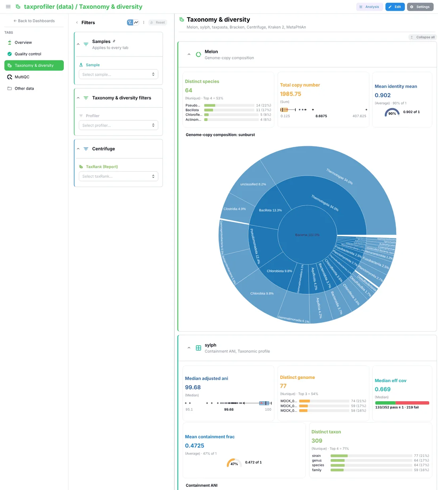
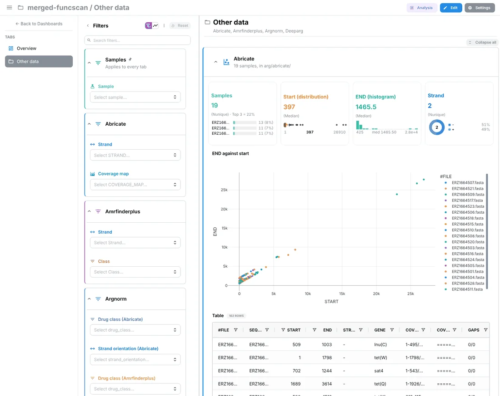

# <span style="color: #45B8AC;">:material-magic-staff:</span> Composed dashboards <small>(v1.16.0+)</small>

When no bundled template fits a results directory, `depictio ingest` builds the
dashboard from what it finds there, the way MultiQC builds its report: each
file the [tools catalog](../../catalog/index.md) recognises becomes a data
collection with the tiles the catalog gives it, laid out in one tab per
pipeline stage. The result is an ordinary [template](templates.md), so
ingestion, refreshes and the dashboard import work as they do with a bundled
one.

```bash
# No bundled template fits: the dashboard is composed from the catalog
depictio ingest results/

# Compose even when a bundled template fits, and add the files the catalog does not know
depictio ingest results/ --compose --include-unknown

# Look first, offline: print what would be composed and write an editable template
depictio template compose results/ -o my_template/
depictio ingest results/ --template my_template/
```

Here a results directory no bundled template fits is previewed with
`depictio template compose`, then ingested into the local server, which
composes the same template and imports the dashboard:

<div class="asciinema-cast" data-cast="assets/casts/depictio-compose.cast" data-poster="npt:0:19" data-idle-time-limit="2.5"></div>

---

## When a dashboard is composed { #when-a-dashboard-is-composed }

`depictio ingest` takes its project from the first of these that applies (see
[Which template a run uses](templates.md#pipeline-id)):

1. `--template` or `--project-config-path`;
2. `--pipeline-id`;
3. a bundled template detected from the run's own records, such as an nf-core
   run's `pipeline_info/`;
4. a template composed from the catalog.

`--compose` skips the third: it composes even when a bundled template fits. It
cannot be combined with `--template` or `--project-config-path`.

Only a local `DATA_DIR` is composed, since the catalog is matched against a walk
of the directory:

- An `s3://` run folder, `--manifest` or `--bind` without `DATA_DIR` still need
  a template. The web UI's [**From a run folder**](remote-data.md#from-a-run-folder)
  does not compose either: a folder no template reads gets **No matching
  template**, and a pipeline has to be picked.
- The [Nextflow trigger](../../depictio-cli/nextflow-trigger.md) passes
  `--pipeline-id` for every pipeline that declares a `manifest`, so a pipeline
  Depictio ships no template for stops at the second step, with exit code 1,
  rather than being composed. Run `depictio ingest <results dir>` yourself.

When the catalog recognises nothing in the directory, the run stops with exit
code 1: *Nothing in … is recognised by the catalog*. The message says how many
tabular files the directory holds, which `--include-unknown` would ingest.

---

## What is recognised { #what-is-recognised }

- The directory is walked once, hidden folders and a top-level `work/` folder
  left out, and each catalog output's `find` (a file name or a path glob) is
  matched against that walk.
- Every `multiqc.parquet` becomes a MultiQC collection, wherever it sits. Its
  plots are listed off the report itself, so the `multiqc` package is not
  needed to compose.
- An output the catalog reads as it is becomes a table collection of the files
  found, in CSV, TSV or parquet.
- An output that a recipe reshapes becomes a recipe collection whose sources
  point at the files found. A file is kept for a recipe only when it has the
  input columns the recipe declares, so a broad `find` such as `*.tsv` does not
  take another tool's tables. A recipe that parses whole reports (Picard,
  RSeQC, samtools stats, Bowtie 2 logs) gets them one line per row, as the
  bundled templates scan them, and a collection that a recipe reads is
  created for it from the raw files when the run has none.
- Each output's renders become tiles, kept when the collection has the
  columns they bind and the dashboard models accept them.
- Every composed collection is optional: one that fails to ingest is skipped
  and the import drops its tiles, instead of the run failing.

Before ingesting, the CLI prints what it decided:

- **Recognised**: each collection with its tool, its stage and its files;
- the tabs, the key metrics, and whether general statistics were joined;
- **Left out**, with a reason for each: a file the scan cannot read, a render
  whose columns are missing, a recipe whose input is absent, a table written
  twice as `.csv` and `.tsv`;
- **Not recognised**: the [tabular files the catalog does not know](#files-the-catalog-does-not-recognise),
  with what each could show. The count in its heading also takes in the
  files that could not be read as a table, which get no line.

`depictio ingest` shows the first 15 items left out and the first 10 files not
recognised; `depictio template compose --verbose` lists them all.

---

## The dashboard { #the-dashboard }

One multi-tab dashboard:

| Tab | What it holds |
|-----|---------------|
| **Overview** | **About this run**: the tools recognised, the MultiQC report and the tabs in pipeline order, then, when the catalog does not know some tabular files, how many were left out, with a pointer to the project page and `--include-unknown` (once all are added, that they are in their tool's tab or in **Other data**). **Key metrics**: the number of samples, then the cards the catalog marks as a tool's [headline](../../developer/contributing-a-tool.md#composition-hints), eight cards in all at most. **General statistics**: MultiQC's General Statistics table, and *Headline metrics per sample, across tools*, one row per sample and one column per headline card |
| One tab per stage | Each stage present, in this order: Quality control, Alignment & coverage, Quantification, Peaks, Variants, Fusions, Taxonomy & diversity, Functional annotation, Immune repertoire, Differential analysis, Benchmarking, Other results. The subtitle lists the tools, and each tool has a section: its cards (eight at most, none twice), figures and advanced visualizations. The tables are folded under **Tables**, and the catalog's filters sit in a *… filters* section |
| **MultiQC** | Every plot of the report, in sections by stage. A run with several reports gets one tab each, named by what tells them apart, such as *MultiQC (test_aws)* |
| **Other data** | Only when files the catalog does not know are [added](#adding-them) |

<figure markdown="span">
  [](../../images/guides/composed/overview_tab_light.webp){target=_blank}
  [](../../images/guides/composed/overview_tab_dark.webp){target=_blank}
  <figcaption>The <strong>Overview</strong> of the dashboard composed in the recording above, from Depictio's catalog conformance outputs and one table the catalog does not know. The key metrics are the sample count and the headline card of mosdepth.</figcaption>
</figure>

A tool's stage comes from the catalog. A MultiQC plot goes to the stage of the
catalog's section for its module, Quality control when the catalog has none.

Colours and icons follow what a tile shows, after the bundled reference
dashboards: a card's colour and icon say what it measures (the sample count is
teal with a flask on every tab), no colour appears twice in a section, and a
section's icon comes from its content. An nf-core run gets the nf-core icon.

<figure markdown="span">
  [](../../images/guides/composed/taxonomy_tab.webp){target=_blank}
  <figcaption>Composed from nf-core/taxprofiler test results: the <strong>Taxonomy &amp; diversity</strong> tab, with a section per tool and the <strong>Samples</strong> filter that applies to every tab.</figcaption>
</figure>

### The Samples filter { #the-samples-filter }

The filter panel opens on one **Sample** filter, in a **Samples** section
pinned at the top and marked *Applies to every tab*, a
[section on every tab](../../features/dashboards.md#persistent-sections). It
narrows every tab:

- `samples.tsv`, written next to the composed template, lists every sample of
  the run: the values of each collection's sample column (`sample`,
  `sample_id`, `sampleid`, `sample_name` or `samplename`), the values read off
  file paths, and the rows of MultiQC's General Statistics.
- A name that extends another at a separator is the same sample:
  *MOCK_001_Illumina_Hiseq_3000_1* in the MultiQC report is *MOCK_001* when a
  path names *MOCK_001*, while *S1* and *S10* stay two samples. Suffixes such
  as `.sorted.bam` are removed first.
- The filter is [linked](../../features/cross-dc-filtering.md) to MultiQC and
  to every collection that names samples: with the `direct` resolver when the
  collection uses the same names, with `sample_mapping` and the variants
  otherwise.
- The sample filters the catalog offers per collection are dropped. A group of
  unrecognised files keeps its filters on columns with 2 to 12 values.

With fewer than two samples, or more than 5,000 names, no `samples.tsv` is
written. The filter then reads the MultiQC report's own sample list; without a
report, a stage tab that has no filter gets a sample filter on its first
collection with a sample column.

---

## Files the catalog does not recognise { #files-the-catalog-does-not-recognise }

Tabular files (`.csv`, `.tsv`, `.tab`, `.txt`, `.parquet`) that no recognised
output uses are proposed, never added silently. Files under `pipeline_info/`
and in the data folder of a MultiQC report are not proposed.

- Files of one shape (the same depth, extension and columns) that differ by one
  value are one proposal, written as a glob: `arg/abricate/*/*.txt`, 19 files.
  The part that varies becomes a column: `sample` when the files have no
  sample column and its values turn up elsewhere in the run under other
  names, `file` otherwise, as for variants of one output such as
  `salmon.merged.gene_*.tsv`.
- A file whose first row is data, not column names (a Kraken report), is read
  without a header, its columns numbered.
- A table written twice, as `.csv` and as `.tsv`, is proposed once.
- Each proposal says what the file would show: up to four numeric columns as
  cards (`card: mean of reads`), up to two filters on columns with 2 to 12
  values, a scatter of the first two numeric columns or a box plot of one by a
  category, and the table.

At most 50 proposals are listed, and at most 2,000 files are read to find
their shape.

### Adding them { #adding-them }

`--include-unknown` adds every proposal. `--include GLOB` adds those with a
file matching the glob, relative to the results directory; it is repeatable.
A glob with no `/` matches a file name at any depth (`'*.tsv'`), a trailing
`**` takes every file below (`'amp/**'`), and a proposal's own glob is taken as
it is. A proposal named by `--include` is added even past the 50 listed.

```bash
depictio ingest results/ --include 'arg/abricate/*/*.txt' --include '*_summary.tsv'
```

Both apply only when the dashboard is composed: with a bundled template that
fits, add `--compose`.

An added group goes where the tool that wrote it is. When a directory on its
path names a catalog tool or MultiQC module (its id, its name, or exactly one
word of it, so `deseq2_qc` is DESeq2's), the group gets a section named after
that tool, in that tool's stage tab, the deepest such directory winning.
Other groups go to the **Other data** tab, one section per directory below
what they share; a top directory that only holds tool directories, such as
`arg/`, is looked through. At ingestion, the value a group's files differ by
is added to their rows as the `sample` or `file` column, from the
[wildcard](yaml-examples.md#recursive-mode) of its scan.

<figure markdown="span">
  [](../../images/guides/composed/other_data_tab.webp){target=_blank}
  <figcaption>Composed from nf-core/funcscan test results with <code>--include-unknown</code>: the <strong>Other data</strong> tab. Abricate's 19 per-sample tables are one collection, its sample read off the path.</figcaption>
</figure>

### On the project page { #on-the-project-page }

The **Data collections** tab of a composed project lists what was left out in a
**Files the catalog did not recognise** card, below its data collections:

| Column | Content |
|--------|---------|
| **File** | The proposal's name and its path or glob, *N files* for a group, and the column holding the samples |
| **Columns** | How many, and the format; their names on hover |
| **Would show** | The tiles it would get |

The copy button of a line copies the command that adds it, and the one in the
card's header the command that adds them all:

```bash
depictio ingest '/data/run42/results' --compose --reset-dashboards --include 'arg/abricate/*/*.txt'
depictio ingest '/data/run42/results' --compose --reset-dashboards --include-unknown
```

The files are on the machine that ran the ingestion, which the server may not
see, so the page gives a command rather than a button: run it there, against
the same server. `--reset-dashboards` rebuilds the dashboard from the new
composition, since a refresh keeps the tabs a dashboard already has as they
are; edits made in the viewer are lost. Add `--project` when the project was
given a name of its own.

---

## Composing offline { #template-compose }

`depictio template compose` composes without ingesting and without a server:
it prints the same report as `ingest`, then writes the template.

```bash
depictio template compose results/ -o my_template/
# edit my_template/template.yaml or my_template/dashboards/composed.yaml, then
depictio ingest results/ --template my_template/
```

| File | Content |
|------|---------|
| `template.yaml` | The template: its id, `composed/<directory>`, a `DATA_ROOT` variable, one workflow named after the pipeline (or `results`) with one data collection per recognised output, the links of the Samples filter, and the files left out with their proposals |
| `dashboards/composed.yaml` | The dashboard |
| `general_stats.tsv` | The headline metrics per sample, across tools |
| `samples.tsv` | Every sample of the run |

`general_stats.tsv` and `samples.tsv` are computed from this run and read from
the template's folder: keep the folder where it is, and compose again for
another run. The options are in the
[CLI reference](../../depictio-cli/usage.md#template-compose).

Without `-o`, the template goes where `depictio ingest` keeps the templates it
composes: `~/.depictio/composed/<directory>-<hash>/`, one folder per results
directory, or the same below `DEPICTIO_COMPOSE_HOME` when it is set. The
composition is deterministic, so composing the same directory again writes the
same template, and a refresh does not reshuffle the dashboard.

The project is named `<directory> (<parent directory>)`, such as
`results (run42)`, unless `--project` names it.

---

## Limits { #limits }

- Only a local results directory is composed: not an `s3://` one, not from the
  web UI, and not through the Nextflow trigger for a pipeline with a
  `manifest`. See [When a dashboard is composed](#when-a-dashboard-is-composed).
- The Samples filter reaches a collection only through a sample-named column
  or its file paths. A table that names samples in a column called otherwise
  is not linked.
- A recipe that reads other collections is left out of the general statistics,
  which are computed from the files before anything is ingested.
- Most catalog outputs render advanced visualizations, and few MultiQC modules
  have a catalog section of their own: their plots are all on the MultiQC tab,
  under Quality control.
- An unrecognised file is added with the command from the project page, not
  from the browser.

## See Also

- [CLI usage](../../depictio-cli/usage.md#ingest-command): `--compose`, `--include-unknown`, `--include`, [`template compose`](../../depictio-cli/usage.md#template-compose)
- [Templates](templates.md#pipeline-id): which template a run uses
- [Contributing a tool](../../developer/contributing-a-tool.md#composition-hints): `stage`, `headline` and `priority` in the catalog
- [Tools catalog](../../catalog/index.md): the outputs a composition can recognise
