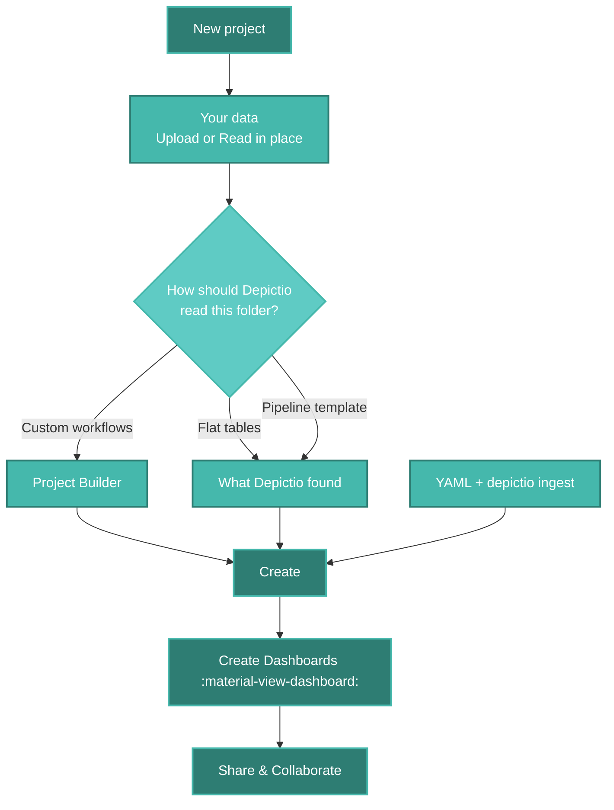
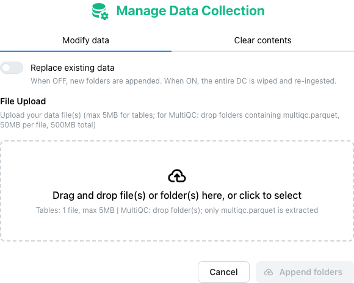
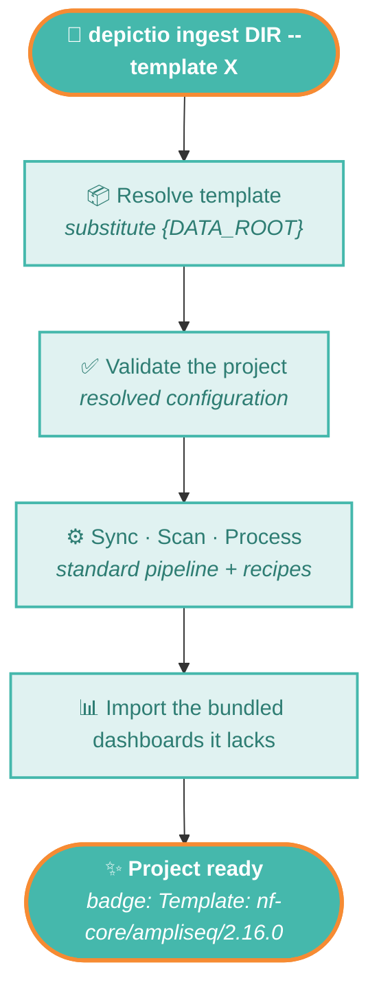

# <span style="color: #45B8AC;">:material-folder-multiple:</span> Projects in Depictio

Projects are the foundation of data organization in Depictio. They hold your data and dashboards, and decide who can use them.

<figure markdown="span"><video preload="none" data-autoplay controls muted loop playsinline poster="../../../images/guides/project-creation/create-project-from-folder.webp" src="../../../images/guides/project-creation/create-project-from-folder.mp4"></video></figure>

## Understanding Project Architecture

Every Depictio project contains:

- **Core Project Information** - Name, description, and metadata
- **Data Organization** - Data collections on their own, or grouped in workflows with one or more runs
- **Permission System** - Role-based access control with owners, editors, and viewers
- **<span style="color: #F68B33;">Dashboard Integration</span>** - Each <span style="color: #F68B33;">:material-view-dashboard: dashboard</span> is linked to a project, allowing for interactive data exploration
- **Storage Backend** - Automatic conversion to Delta Lake format for optimal performance

### Project Lifecycle



## Create a project <small>(v1.21.0+)</small> { #create-a-project }

A project starts from its data. Depictio reads what you give it and works out whether it holds plain tables or the run of a pipeline. There is no Basic or Advanced choice to make.

[](../../images/guides/project-creation/projects_page_light.webp){target=_blank}
[](../../images/guides/project-creation/projects_page_dark.webp){target=_blank}

### Name the project

On **Projects**, click **New project**. In public or demo mode the button is disabled for users who are not admins.

The first screen asks for a **Project name**, an optional **Description**, and **Make this project public**. Then pick one of two choices:

- **Add data**: files, a folder, a pipeline run or your own pipeline's outputs.
- **Create without data**: an empty project, filled later with [Add data](#add-data).

Under **Or start from**, **Import a project** brings in a project exported from Depictio (see [Project migration](../administration/migrate.md#web-ui)). **See an example** opens a finished project to explore, and shows only when the server holds one.

[{ width="569" }](../../images/guides/project-creation/new_project_dialog_light.webp){target=_blank}
[{ width="569" }](../../images/guides/project-creation/new_project_dialog_dark.webp){target=_blank}

### Your data

**Add data** opens a stepper: **Your data**, **What Depictio found**, **Create**. The button in the dialog's header, **Use the whole window**, gives the stepper the full screen.

*Your data* has two sides, which you can combine:

- **Upload**: drop files or whole folders from your computer, up to 50 MB each. Tables, MultiQC reports, phylogenetic trees, GeoJSON maps and images are recognised automatically.
- **Read in place**: nothing is uploaded. Choose **Folder or bucket** for an `s3://` location, or a folder on the server's disk (**Browse** picks one where the server allows it, as under `depictio local`). Choose **One file URL** for a single `https://` or `s3://` CSV, TSV, Parquet or Feather file, gzipped or not.

[](../../images/guides/project-creation/your_data_step_light.webp){target=_blank}
[](../../images/guides/project-creation/your_data_step_dark.webp){target=_blank}

[](../../images/guides/project-creation/read_in_place_url_light.webp){target=_blank}
[](../../images/guides/project-creation/read_in_place_url_dark.webp){target=_blank}

| Format      | Extension            | Best Use Case                           |
| ----------- | -------------------- | --------------------------------------- |
| **CSV**     | `.csv`               | Most common, universal compatibility    |
| **TSV**     | `.tsv`, `.tab`       | Tab-separated, good for scientific data |
| **Parquet** | `.parquet`, `.pq`    | Large datasets, optimal performance     |
| **Feather** | `.feather`, `.arrow` | Fast I/O, preserves data types          |

### How Depictio reads a folder { #read-levels }

Once a folder is read, **How should Depictio read this folder?** offers three levels, from the least to the most structured. The best fit is preselected, and a level that does not fit stays visible with the reason.

| Level | What it makes |
|-------|---------------|
| **Flat tables** | One collection per table file, with no workflow and no dashboards. |
| **Custom workflows** | Collections you define yourself in the [Project Builder](#project-builder), grouped by the workflow that made them. |
| **Pipeline template** | A recognised pipeline, read with Depictio's [template](templates.md) for it, dashboards included. |

When a pipeline is recognised, a line reads **Pipeline:** *name version* **· Detected**, with **Change** to pick another. When none is, **I know the pipeline** (or **Choose the pipeline** on the *Pipeline template* tile) opens the picker.

[](../../images/guides/project-creation/read_levels_light.webp){target=_blank}
[](../../images/guides/project-creation/read_levels_dark.webp){target=_blank}

### What Depictio found, then Create

*What Depictio found* lists the facts and checks before anything is written: the pipeline, the runs, the source and the contents. For flat tables you tick the tables to keep, and **Create project with N tables** creates the project from there. For a pipeline, **Next** leads to *Create*, and **Create Project** starts the ingestion.

[](../../images/guides/project-creation/what_depictio_found_light.webp){target=_blank}
[](../../images/guides/project-creation/what_depictio_found_dark.webp){target=_blank}

The project page then says in its header what the project holds: its **Pipeline**, its **Runs**, its **Data collections** and their **Source**.

[](../../images/guides/project-creation/project_header_found_light.webp){target=_blank}
[](../../images/guides/project-creation/project_header_found_dark.webp){target=_blank}

### Project shapes

What the read level picks shows in the project's shape. `project_type` is still accepted in YAML (`basic` or `advanced`) so older files and exports validate, but it changes nothing: every project can take data from the viewer and from the CLI.

| Shape | Holds | Made with |
|-------|-------|-----------|
| Tables only | Data collections, no workflow | **Flat tables**, uploads, or a YAML with top-level `data_collections` |
| One or more runs of a pipeline | A workflow whose collections are read from each run folder | **Custom workflows**, the [Project Builder](#project-builder), or a YAML with `workflows` |
| From a template | A pipeline's workflow, recipes and dashboards | **Pipeline template**, or `depictio ingest DIR --template ID` |

### Create a project with the CLI { #create-with-the-cli }

A YAML file describes the project, and `depictio ingest` creates it. A project of tables only lists its data collections at the top level:

```yaml
# tables_project.yaml
name: "My Project"
data_collections:
  - data_collection_tag: "my_data"
    config:
      type: "Table"
      metatype: "Metadata"
      scan:
        mode: "single"
        scan_parameters:
          filename: "/path/to/data.csv"
      dc_specific_properties:
        format: "CSV"
        polars_kwargs:
          separator: ","
          has_header: true
```

```bash
depictio ingest --project-config-path tables_project.yaml
```

For a pipeline's outputs, see [Projects with a workflow](#projects-with-a-workflow) or [Template Projects](#template-projects).

## Add data to a project { #add-data }

**Add data** on the project page opens the same two sides as *Your data*: **Upload** and **Read in place**. What Depictio does depends on the folder. Another run of the project's pipeline is added as a run, and any other folder offers its tables as new collections.

The button says what will happen: **Add run**, **Add N tables**, or **Add run and N tables**. Before you click it, *What Depictio found* shows the pipeline, the new runs, the source and the contents of the folder.

[](../../images/guides/project-creation/add_data_run_light.webp){target=_blank}
[](../../images/guides/project-creation/add_data_run_dark.webp){target=_blank}

<figure markdown="span"><video preload="none" data-autoplay controls muted loop playsinline poster="../../../images/guides/project-creation/add-run.webp" src="../../../images/guides/project-creation/add-run.mp4"></video></figure>

A run whose MultiQC reports name samples already in the project is not added. The **Samples** row lists them with a warning: rename the samples in this run, or read it as its own project.

[](../../images/guides/project-creation/duplicate_samples_light.webp){target=_blank}
[](../../images/guides/project-creation/duplicate_samples_dark.webp){target=_blank}

Only a project made from a pipeline template takes another run, and only when its collections walk a folder. A project read from an `s3://` run folder uses `s3_prefix` scans, which cannot take a second run. From the CLI, `depictio ingest --attach-run` does the same.

### Edit a table { #edit-a-table }

A table you added, uploaded or read from a folder, can be edited like a spreadsheet, typically a sample sheet. Tables from a pipeline run or a template stay read-only, since the next ingestion would overwrite them.

Each table has a lock switch, **Read-only** by default. Turn it on to make the table **Editable**, then click a cell to change it: every save is a new version. Dropping a file on the table previews **Add columns**, **Fill missing** or **Replace** before anything is written.

The table's past versions stay readable. **Restore** on one of them (**Restore v3**, for instance) writes it back as a new version, so nothing is lost.

[](../../images/guides/metadata-panel/table_edit_mode_light.webp){target=_blank}
[](../../images/guides/metadata-panel/table_edit_mode_dark.webp){target=_blank}

A table whose columns look like a latitude and longitude pair shows **Map coordinates…**, see [Map-capable Table DCs](#example-map-capable-table-dcs). Each collection records its origin, shown as its **Source** (or **Uploaded file**) and the date it was **Added**.

### Manage a data collection { #managing-data-collections-from-the-viewer-v0120 }

In the project's list of collections, the :material-database-cog-outline: icon of a row (**Manage data (append / replace / clear)**) opens **Manage Data Collection**. Without edit rights on the project it is greyed out, with **Owner permission required**. A later CLI refresh keeps what was added in the browser (see [Refreshing a project](../../depictio-cli/usage.md#refreshing-a-project)).

| Tab | What it does | Button |
|-----|--------------|--------|
| **Modify data** | Drop files or folders to add them to the collection. A table takes one file of at most 5 MB; MultiQC takes folders holding `multiqc.parquet` (50 MB per file, 500 MB in all) | **Append folders** |
| **Modify data**, **Replace existing data** on | The collection is wiped and ingested again from the dropped files | **Replace all data** |
| **Clear contents** | Deletes all the data and reports. The collection, its name and its links stay. Type the collection name to confirm | **Clear data collection** |

<!-- TODO recapture: Manage data modal (v1.21.0) -->
<figure markdown="span">
  
  <figcaption><em>Manage Data Collection</em>: <em>Modify data</em> appends or replaces, <em>Clear contents</em> drops the data and keeps the collection.</figcaption>
</figure>

MultiQC reports are checked for **uniformity** before a create or an append: the same modules, plot keys and MultiQC version across runs, and no sample twice. Reports that differ are refused, so plots stay consistent.

Collections read from a manifest, a URL or a bucket are re-read from **Project settings** > **Data refresh**. By default only what changed is read again; **Read everything again** rebuilds every collection.

## Project Builder <small>(v1.21.0+)</small> { #project-builder }

The Project Builder defines a project's collections yourself, for a folder no shipped template fits. It writes the same YAML as the CLI uses.

### In the app

The builder lives at `/projects/build`. *New project* opens it when you pick **Custom workflows** for a folder (**Open the Project Builder**). It has three steps: **Source & project**, **Data collections**, **Review & create**.

[](../../images/guides/project-creation/builder_source_light.webp){target=_blank}
[](../../images/guides/project-creation/builder_source_dark.webp){target=_blank}

You start from scratch, from a folder, or from a shipped template to adjust. The builder covers every collection kind, path wildcards, run detection by regular expression, and links between collections. A GitHub URL fills the workflow's metadata from its RO-Crate or Nextflow manifest.

[](../../images/guides/project-creation/builder_collections_light.webp){target=_blank}
[](../../images/guides/project-creation/builder_collections_dark.webp){target=_blank}

[](../../images/guides/project-creation/builder_review_light.webp){target=_blank}
[](../../images/guides/project-creation/builder_review_dark.webp){target=_blank}

### Without a server

On a machine with no Depictio server, such as an HPC login node, the builder runs on its own and reads only the folder you give it:

```bash
uv tool install 'depictio[builder]'
depictio project-builder ./results            # --out DIR, --port 8129
```

It opens `http://127.0.0.1:8129/projects/build` and writes a template bundle to `<dir>/.depictio/template`. Run it against any server with:

```bash
depictio ingest ./results --template ./results/.depictio/template
```

## Projects with a workflow { #projects-with-a-workflow }

A workflow groups the collections one pipeline writes, read from one or more run folders. This suits core-facility setups where standard pipelines produce the same files for many samples or runs. In YAML, collections sit under `workflows` instead of at the top level.

### Project Structure Example

```text
study_directory/
├── depictio_project.yaml    # Configuration file
├── run_001/                 # First sample batch
│   ├── sample_A/
│   │   ├── stats/
│   │   │   └── sample_A_stats.tsv
│   │   └── analysis_results/
│   │       └── sample_A_analysis.tsv
│   └── sample_B/
│       ├── stats/
│       │   └── sample_B_stats.tsv
│       └── analysis_results/
│           └── sample_B_analysis.tsv
└── run_002/                 # Second sample batch
    ├── sample_C/
    │   ├── stats/
    │   │   └── sample_C_stats.tsv
    │   └── analysis_results/
    │       └── sample_C_analysis.tsv
    └── sample_D/
        ├── stats/
        │   └── sample_D_stats.tsv
        └── analysis_results/
            └── sample_D_analysis.tsv
```

### Configuration File Format

A YAML configuration describes how the files are organized:

```yaml
# =============================================================================
# DEPICTIO PROJECT WITH A WORKFLOW
# =============================================================================

# Project identification
name: "RNA-seq Expression Study"
description: "Multi-sample RNA sequencing analysis"
is_public: false

# Workflow definition
workflows:
  - name: "rnaseq_pipeline"

    # Workflow engine information
    engine:
      name: "nextflow" # or "snakemake", "python"
      version: "24.10.3"

    description: "nf-core RNA-seq analysis pipeline"
    repository_url: "https://github.com/my-org/my-nf-wf-rnaseq"

    # Data organization configuration
    config:
      # Data location settings
      parent_runs_location:
        - "{DATA_LOCATION}/rnaseq-results" # Environment variable
        - "/absolute/path/to/data" # Alternative absolute path

      # Run identification pattern
      runs_regex: ".*" # Matches all directories

      # Data collections definition
      data_collections:
        # Sample statistics collection
        - data_collection_tag: "sample_stats"
          description: "Per-sample quality control statistics"

          config:
            type: "Table"
            metatype: "Aggregate" # Combine multiple files

            # File discovery settings
            scan:
              mode: "recursive"
              scan_parameters:
                regex_config:
                  pattern: "stats/.*_stats.tsv"

            # Processing configuration
            dc_specific_properties:
              format: "TSV"
              polars_kwargs:
                separator: "\t"
                has_header: true

              # Column selection for performance
              keep_columns:
                - "sample_id"
                - "total_reads"
                - "mapped_reads"
                - "quality_score"

              # Human-readable descriptions
              columns_description:
                sample_id: "Unique sample identifier"
                total_reads: "Total sequencing reads"
                mapped_reads: "Successfully aligned reads"
                quality_score: "Overall sample quality metric"

        # Analysis results collection
        - data_collection_tag: "gene_expression"
          description: "Gene expression analysis results"

          config:
            type: "Table"
            metatype: "Aggregate"

            scan:
              mode: "recursive"
              scan_parameters:
                regex_config:
                  pattern: "analysis_results/.*_analysis.tsv"

            dc_specific_properties:
              format: "TSV"
              polars_kwargs:
                separator: "\t"
                has_header: true

              keep_columns:
                - "sample_id"
                - "gene_id"
                - "expression_level"
                - "p_value"

# Cross-DC Links: Interactive filtering between data collections
links:
  - source_dc_id: "sample_stats"      # Filter from this DC
    source_column: "sample_id"         # Filter by this column
    target_dc_id: "gene_expression"    # Update this DC
    target_type: "table"               # Target type: table or multiqc
    link_config:
      resolver: "direct"               # Same value in both DCs
```

### File Discovery Patterns

A collection uses one of five scanning modes. Two walk a local directory tree,
`single` and `recursive`. Three fetch data from where it already is, `url`,
`s3_prefix` and `manifest`, and are covered on
[Remote data and manifests](remote-data.md).

#### Single File Mode

Perfect for metadata files or summary statistics generated once per project:

```yaml
scan:
  mode: "single"
  scan_parameters:
    filename: "general_metadata_project_info.csv"
```

#### Recursive Mode

Uses regex patterns to find files at any directory depth:

```yaml
scan:
  mode: "recursive"
  scan_parameters:
    regex_config:
      pattern: "star_salmon/.*/quant.sf"
```

#### Remote Modes <small>(v1.16.0+)</small> { #remote-modes }

A collection can also point at one file on the web or in a bucket (`url`), at
every object under an S3 prefix (`s3_prefix`), or at the entries of a Data
Manifest (`manifest`). Whoever ingests reads the files from there, the CLI or
the server, so these modes also work from the web UI with no CLI installed, and
the server can refresh them later. On the CLI, `--bind TAG=LOCATION` picks
the mode from the shape of the location, so a template written for a local tree
can be run against a bucket:

```bash
depictio ingest --template my-lab/rnaseq-qc/1 \
  --bind samples=s3://my-bucket/run42/*.samples.csv
```

See [Remote data and manifests](remote-data.md) for the modes, the manifest
contract, and how to refresh or share such a project.

### CLI Workflow

Ingest a project with a workflow using the CLI:

```bash
# Complete workflow execution
depictio ingest --project-config-path ./rnaseq_project.yaml
```

The CLI executes this pipeline:

1. **✅ Server Check** - Verify connection to Depictio backend
2. **✅ S3 Storage Check** - Validate cloud storage configuration
3. **✅ Config Validation** - Ensure YAML structure is correct
4. **✅ Config Sync** - Register project with server
5. **✅ File Scan** - Discover files matching patterns
6. **✅ Data Process** - Convert files to Delta Lake format
7. **✅ Joins** - Run the table joins the project configuration defines
8. **✅ Dashboards** - Import the dashboards the project lacks, from the template or from `--dashboard`

`--skip STEP` leaves steps out, for instance `--skip dashboards`. See
[Skipping steps](../../depictio-cli/usage.md#skipping-steps).

## Type-specific Data Collection configuration { #type-specific-data-collection-configuration }

Some visualization types need extra metadata declared **at the Data Collection level** (e.g. which columns hold coordinates, which hold sample IDs, log-fold-change, p-values, …). Declaring this on the DC means every figure built on top inherits the config, with no need to re-specify it per component.

This pattern is being rolled out incrementally. The first shipped example is **:material-map-marker-multiple: Map**; advanced-viz types (volcano, ComplexHeatmap, UpSet, GSEA enrichment, rarefaction, …) will follow the same pattern.

#### :material-map-marker-multiple: Example: Map-capable Table DCs { #example-map-capable-table-dcs }

Tabular DCs can be marked Map-capable so every Map figure built on them inherits the same coordinates without re-specifying `lat_column` / `lon_column`:

- **In the viewer**: a table whose columns look like a lat/lon pair shows **Map coordinates…**. You confirm or change the columns Depictio picked.
- **At upload time**: `POST /create_from_upload` accepts `latColumn` and `lonColumn` query params with column-existence validation.
- **In YAML**: use `DCTableCoordinatesConfig` on the DC's config block (see [YAML examples](yaml-examples.md)).

Per-figure `lat_column`/`lon_column` overrides still work when set; if both are unset, the DC-level config is used.

#### :material-family-tree: Example: Phylogeny DCs and their metadata table

A `phylogeny` DC is file-backed: the `.nwk` / `.nex` file is read where it was
found, never parsed or converted. What it declares at the DC level is **where its
tip annotations come from**: a separate Table DC keyed by taxon name, the same
split Microreact uses. Every phylogenetic figure built on the tree inherits that
join.

```yaml
- data_collection_tag: "bacterial_tree"
  description: "Bacterial phylogeny (21 taxa), Newick format"
  config:
    type: "phylogeny"
    metatype: "Aggregate"
    scan:
      mode: "single"
      scan_parameters:
        filename: "{DATA_ROOT}/trees/bacterial_tree.nwk"
    dc_specific_properties:
      format: "newick"          # or "nexus"
      ladderize: true
      metadata_dc_tag: "bacterial_metadata"
      metadata_taxon_column: "taxon"

- data_collection_tag: "bacterial_metadata"
  description: "Tip metadata (group / habitat / resistance)"
  config:
    type: "Table"
    metatype: "Aggregate"
    scan:
      mode: "single"
      scan_parameters:
        filename: "{DATA_ROOT}/trees/bacterial_metadata.tsv"
    dc_specific_properties:
      format: "TSV"
      polars_kwargs:
        separator: "\t"
```

Leave the three metadata keys out and the tree still renders, just unannotated.
Use `tip_label_strategy: "first_token"` when leaf names carry a suffix
(`Escherichia_coli_K12` → `Escherichia_coli`).

A component then points at the tree with `tree_wf_id` / `tree_dc_id` and colours
its tips from any column of the metadata DC. See
[Phylogenetic](../../features/advanced-visualizations.md#phylogenetic) for the component
schema and its controls.

#### :material-dna: Example: Indexed-file DCs { #example-indexed-file-dcs }

An `indexed_file` DC is file-backed too, and it is the one to reach for when a genomic
file is too large or too dense to become a table: a per-sample VCF, a BAM, a coverage
bigWig, an annotation GFF3, or any bgzip-compressed, tabix-indexed interval file such as a
BED. Ingestion builds no Delta table. It copies each matched file and its index sidecar to
S3, one object per sample, and a genome track in the browser asks the API for presigned
URLs and range-reads only the part of the file covering the region in view.

```yaml
- data_collection_tag: "variant_files"
  description: "Annotated VCF per sample with its tabix index"
  optional: true
  config:
    type: "indexed_file"
    metatype: "Metadata"
    scan:
      mode: "recursive"
      scan_parameters:
        regex_config:
          pattern: ".*\\.ann\\.vcf\\.gz$"
    dc_specific_properties:
      format: "vcf"            # vcf, bam, bigwig, bigbed, gff3, fasta or tabix
      assembly: "{GENOME}"     # genome axis of the tracks reading this DC
      sample_regex: "(?P<sample>[^/]+?)\\.ann\\.vcf\\.gz$"
      max_file_size_mb: 64     # files above the cap are skipped with a warning
```

| Key | Default | Meaning |
|-----|---------|---------|
| `format` | required | Which lazy reader the track uses. `tabix` covers any bgzip + tabix interval file that is not a VCF or GFF3. `bw`, `bb` and `gff` are accepted as aliases. |
| `index_suffix` | per format | Suffix of the index beside each file: `.tbi` for `vcf`, `gff3` and `tabix`, `.bai` for `bam`, `.fai` for `fasta`, none for the self-indexed `bigwig` and `bigbed`. Set it only when the pipeline names its indexes differently; an empty string declares a self-indexed file. |
| `sample_regex` | file name | A regular expression with a named `sample` group, matched against the file path. Without it, the file name minus its format and compression suffixes is the sample. |
| `sample_col` | `sample` | The name the sample id has in the project's tables, so a file track can sit beside table-backed tracks and answer the dashboard's sample filter. It is not a column of this DC. |
| `assembly` | none | Genome assembly the files are aligned to. Left out, the component config decides. |
| `max_file_size_mb` | `512` | Per-file upload cap. |

The scan matches **one primary file per sample**. A file with no index beside it is skipped
with a warning rather than uploaded unreadable, and a second file resolving to a sample
already taken is skipped too, so which file wins never depends on scan order. Making the DC
`optional`, as above, keeps a run that was fetched without its index sidecars from failing
the whole ingestion.

Prefer a `table` DC when the data is small enough to filter and aggregate as rows: cards,
figures and tables read rows, and an `indexed_file` DC has none. Its consumer is a genome
track reading files directly: a [Genome view](../../features/advanced-visualizations.md#genome-view)
tile with `source: file`.

##### Storage the browser can read <small>(v1.13.0+)</small> { #indexed-file-storage }

The bytes of an indexed file never pass through the API: the browser reads them from the
object store itself, with the presigned URLs the API hands out (valid 15 minutes). Two
things follow for a deployment:

- **The URLs are signed for the address the browser uses.** The API signs them against
  `DEPICTIO_S3_PUBLIC_URL` when it is set, otherwise against
  `DEPICTIO_S3_EXTERNAL_PROTOCOL`, `DEPICTIO_S3_EXTERNAL_HOST` and
  `DEPICTIO_S3_EXTERNAL_PORT` (the older `DEPICTIO_MINIO_*` names still work). A signature
  covers the host, so a URL signed for an in-cluster name such as `http://s3:9000` fails in
  the browser.
- **The store must answer the viewer's origin with CORS and serve range requests.** The
  bundled SeaweedFS allows every origin by default; narrow it with
  `-s3.allowedOrigins=https://viewer.example.org`, through the `s3` service's `command` in
  Docker Compose or `s3.extraArgs` in the Helm chart. On AWS S3 or another gateway, add a
  bucket CORS rule allowing `GET` and `HEAD` from the viewer's origin, with `Range` among the
  allowed headers and `Content-Range`, `Content-Length`, `Accept-Ranges` and `ETag` exposed.

Without this, a genome view shows no file tracks. Tracks read from table DCs are unaffected.

#### :material-chart-timeline: Example: genomic_tracks DCs { #example-genomic-tracks-dcs }

A `genomic_tracks` DC is a **manifest of track files**: one row per bigWig, narrowPeak,
BAM, VCF or other genome-browser file, with the file's location in `uri_column`. The
manifest is ingested like a table, so it can be filtered, linked and joined like one, and
the [genome browser](../../features/genome-browser/index.md) shows the tracks of the rows left
after filtering. The track files themselves stay files: a relative `uri` is uploaded to
Depictio's S3 at ingestion, and an `s3://` or `https://` one is read in place.

This is the DC of the nf-core/chipseq dashboard template:

```yaml
- data_collection_tag: "tracks"
  description: "Genome-browser tracks of the run, one row per file"
  config:
    type: "genomic_tracks"
    metatype: "Metadata"
    source: "transformed"
    transform:
      recipe: "nf-core/chipseq/tracks.py"   # builds the manifest from the run's results
    dc_specific_properties:
      format: "TSV"
      uri_column: "uri"
      track_id_column: "track_id"
      sample_column: "sample_id"            # what a link or a click filters on
      format_column: "format"
      name_column: "name"
      color_column: "color"
      category_column: "category"
      order_column: "order"
      assembly: "hg19"
      display_defaults:                     # JBrowse config merged into every track of a format
        bigwig:
          displays:
            - type: "LinearWiggleDisplay"
              height: 60
              autoscale: "local"
```

A project that writes its own manifest uses `scan` instead of `transform`, pointing at the
TSV, and can set `remote_base_uri` to read relative `uri` values in place under an
`s3://` or `https://` prefix instead of uploading them. Only hosts and buckets on the
server's allow-list can be read in place, see
[Security](../../features/security.md#genome-browser-track-access).

| Key | Default | Meaning |
|-----|---------|---------|
| `uri_column` | `uri` | Column holding the track location: a relative path, an `s3://` URI or an `https://` URL. |
| `track_id_column` | the `uri` | Column with a unique id per track. |
| `sample_column` | none | The entity a track belongs to (sample, cell, ...). Cross-filtering and the browser's selection use it. |
| `format_column` | `format` | Column with the track format. Without it the format is read from the file extension, falling back to `default_format`. |
| `index_column` | `index_uri` | Column with the index location. Left empty, the conventional sibling is used (`.bai`, `.crai`, `.tbi`, `.fai`). |
| `name_column`, `color_column`, `category_column`, `order_column` | none | Track label, colour, folder in the track selector, and the order the tracks open in. |
| `assembly` | `hg38` | A preset (`hg38`, `hg19`, `hs1`, `mm10`, `mm39`, `sacCer3`, `dm6`, `ce11`, `danRer11`, `TAIR10`, `wuhCor1`) or a custom assembly given by a FASTA with its index, or a 2bit file. |
| `direct_access` | `false` | Let the browser fetch `https://` tracks itself instead of through the API. The host must send CORS and Range headers. |

Supported formats are bigWig, bedGraph, BED, bigBed, narrowPeak, broadPeak, VCF, BAM,
CRAM, GFF3, GTF and FASTA. A link whose `target_type` is `genomic_tracks` lets a table
selection pick the tracks to show, and a click in the browser filters the other
components back, see [Cross-DC filtering](../../features/cross-dc-filtering.md#supported-target-types).

For per-sample files read directly by a Genome view tile, with no manifest, see
[Indexed-file DCs](#example-indexed-file-dcs).

#### :material-molecule: Example: Protein structure DCs <small>(v1.19.0+)</small> { #example-protein-structure-dcs }

Protein structures and predicted aligned error (PAE) matrices are `indexed_file` DCs too,
one file per protein. They need no index: a
[protein tile](../../features/proteins.md#the-data) fetches the file whole.

```yaml
- data_collection_tag: "structures"
  description: "Top-ranked predicted structure per target"
  config:
    type: "indexed_file"
    metatype: "Metadata"
    scan:
      mode: "recursive"
      scan_parameters:
        regex_config:
          pattern: ".*/top_ranked_structures/[^/]+\\.pdb$"
    dc_specific_properties:
      format: "pdb"            # pdb, mmcif or pae
      sample_regex: "top_ranked_structures/(?P<sample>[^/]+?)\\.pdb$"
```

| `format` | Files |
|----------|-------|
| `pdb` | `.pdb`, `.ent`, gzipped or not. Predictors write pLDDT into the B-factor column |
| `mmcif` | `.cif`, `.mmcif`, gzipped or not |
| `pae` | `.pae.tsv` (proteinfold) or `.pae.json` (AlphaFold DB, ColabFold) |

The sample id the scan derives must equal the `entity` value of the residue tables, which is
how a tile finds the structure of the protein it shows.

## Template Projects

<!-- prettier-ignore -->
!!! success "Perfect for: nf-core pipelines and standardized bioinformatics workflows"

    **Use when:** You have output from a supported pipeline (e.g. nf-core/ampliseq) and want a fully configured project + dashboards in one command, without writing any YAML.

Templates are pre-packaged project configurations that ship with Depictio. Each template bundles a project YAML (with `{DATA_ROOT}` placeholders), bundled dashboards, and referenced data transformation recipes for a specific pipeline version.

### One-command setup

```bash
depictio ingest /data/my_ampliseq_run \
  --template nf-core/ampliseq/2.16.0
```

That single command:

1. Resolves all `{DATA_ROOT}` placeholders, and the template's other variables, throughout the config
2. Creates the project in MongoDB
3. Discovers and processes all data collections (running recipes automatically)
4. Imports the bundled dashboard

Without `--template`, the template is detected from the results directory when it can be, and since v1.16.0 a local directory no bundled template fits gets one [composed from the catalog](composed-dashboards.md). Running the same command again with `--update-config` refreshes the project and keeps its dashboards as edited in the viewer; see [Refreshing a project](../../depictio-cli/usage.md#refreshing-a-project).

The results directory can also be an `s3://` prefix, a manifest-driven template takes `--manifest <url or path>` in place of the directory, and any template can be pointed at other locations, collection by collection, with `--bind TAG=LOCATION`. In the viewer, **New project** with **Pipeline template** does the same, see [Create a project](#create-a-project). See [Remote data and manifests](remote-data.md).

### When to use templates

Use templates when:

- ✅ You ran a supported nf-core pipeline (e.g. ampliseq) and want instant visualization
- ✅ You want a reproducible, versioned project setup you can share with collaborators
- ✅ You prefer not to write project YAML from scratch

Use a YAML config or the [Project Builder](#project-builder) when:

- ✅ Your pipeline is not yet covered by a bundled template
- ✅ You need highly customized data collection patterns or scan configurations
- ✅ You want fine-grained control over which files are included

### Template workflow diagram



### Template origin badge

Once imported, every dashboard card in the UI shows a badge:

```
Template: nf-core/ampliseq/2.16.0
```

This tells you and your collaborators which template generated the project, enabling template discovery and making provenance visible throughout the UI.

For full template reference — available templates, data validation levels, YAML structure, and all CLI flags — see **[Templates](templates.md)**.

## <span style="color: #45B8AC;">:material-lock:</span> Project Permissions { #project-permissions }

Depictio implements a comprehensive role-based permission system:

### Permission Roles

| Role       | Capabilities                                    |
| ---------- | ----------------------------------------------- |
| **Owner**  | Full control - edit, delete, manage permissions |
| **Editor** | Modify project data, create/edit dashboards     |
| **Viewer** | Read-only access to project and dashboards      |

Since **v1.18.0** a role can be given to a person or to a whole
[group](../administration/groups.md), from the **Groups** section of the project's
**Permissions** page. A person's role is the highest of their own and their groups': a
direct viewer whose group owns the project is an owner. Writing a data collection needs
**editor**, deleting one **owner**. The project settings no longer change who has access:
sharing goes through **Permissions** only.

### Everyone with access <small>(v1.19.0+)</small> { #everyone-with-access }

The **Permissions** page sums direct and group grants into **Everyone with access**: one row
per person, highest role first, with every grant behind it. Typing a group's name in the add
box previews its members before **Add group**, flagging those who already have access. Both
show members' emails, so only those who may change the sharing see them: owners, system
admins and the admins of an owning group.

### Public Projects

Projects can be made public by:

- Setting `is_public: true` in configuration
- Using the web interface toggle

Public projects are:

- ✅ Visible to all users
- ✅ Read-only for non-members
- ✅ Searchable in project listings
- ❌ Only editable by *owners* and *editors*
- ❌ Not editable by *viewers* or anonymous users

## :material-trash-can: Project deletion

Deleting a project (via the Web UI or `DELETE /depictio/api/v1/projects/{id}`)
cascades to all dependent state:

- Workflows declared in the project
- Data collections (and their MongoDB documents)
- Dashboards owned by the project
- S3 objects under `s3://<bucket>/{project_id}/`

There is no soft-delete or trash bin — once the operation completes, the
project's data is unrecoverable. Use [Project migrate](../administration/migrate.md)
to take a portable backup ZIP before deletion if you need rollback capability.

!!! note "Self-migration shortcut"
    Migrating a project to the same instance (source == target) skips the
    S3 copy step but still produces a complete export ZIP — useful for
    backing up immediately before a delete.

## 💾 Data Storage Architecture

### Delta Lake Backend

All project data is automatically converted to [Delta Lake](https://delta.io/) format which provides following benefits:

- **ACID Transactions** - Reliable data consistency
- **Time Travel** - Version history and rollback capabilities
- **Schema Evolution** - Handle changing data structures
- **Optimized Queries** - Fast dashboard performance
- **Compression** - Efficient storage utilization

Future Depictio versions will support aforementioned features progressively, enhancing user experience and data management capabilities.

### Storage Hierarchy

```text
Project Storage Structure:
├── metadata/           # Project configuration and metadata
├── data_collections/   # Raw data collections
│   ├── collection_1/
│   │   ├── delta_table/  # Optimized Delta Lake format
│   │   └── metadata.json # Collection-specific metadata
│   └── collection_2/
├── dashboards/        # Dashboard configurations
└── permissions/       # Access control data
```

### Performance Optimizations

- **Lazy Loading** - Load data only when needed
- **Column Pruning** - Select only required columns
- **Predicate Pushdown** - Filter data at storage level
- **Caching** - Cache frequently accessed data
- **Partitioning** - Optimize queries by partition keys

## 🔧 Advanced Configuration Options

### Environment Variables

Use environment variables for flexible deployments:

```yaml
# Configuration with environment variables
parent_runs_location:
  - "{DATA_LOCATION}/study1" # Resolved at runtime
  - "{BACKUP_LOCATION}/study1" # Alternative location
```

### Polars Integration

Advanced data processing with [Polars](https://pola.rs/) DataFrames:

```yaml
dc_specific_properties:
  format: "CSV"
  polars_kwargs:
    separator: ","
    has_header: true
    skip_rows: 1
    column_types:
      sample_id: "String"
      expression: "Float64"
      p_value: "Float64"
    null_values: ["NA", "NULL", ""]
```

### Cross-DC Links

Interactive filtering between data collections at runtime:

```yaml
links:
  - source_dc_id: "metadata"           # Filter from this DC
    source_column: "sample_id"          # Filter by this column
    target_dc_id: "multiqc_report"      # Update this DC
    target_type: "multiqc"              # Target type: table or multiqc
    link_config:
      resolver: "sample_mapping"        # Maps canonical IDs to MultiQC variants
```

See [Cross-DC Filtering](../../features/cross-dc-filtering.md) for details.

### Custom Workflows

Support for various workflow engines:

```yaml
engine:
  name: "nextflow" # or "snakemake", "python", "cwl", "galaxy"
  version: "24.10.3" # Version for reproducibility

catalog:
  name: "nf-core" # Workflow catalog
  url: "https://nf-co.re/rnaseq"
```

## 🚀 Best Practices

### Project Organization

1. **Naming Convention** - Use descriptive, consistent names
2. **Documentation** - Include comprehensive descriptions
3. **Version Control** - Track configuration changes
4. **Testing** - Validate configurations before deployment

### Data Management

1. **File Organization** - Maintain consistent directory structures
2. **Metadata** - Include comprehensive column descriptions
3. **Validation** - Use schema validation for data quality
4. **Backup** - Implement regular backup strategies

### Performance Optimization

1. **Column Selection** - Use `keep_columns` to reduce memory usage
2. **File Formats** - Prefer Parquet over CSV for large datasets
3. **Partitioning** - Organize data by frequently queried columns
4. **Indexing** - Create appropriate indexes for query patterns

### Collaboration

1. **Permission Management** - Set appropriate access levels
2. **Documentation** - Maintain clear project documentation
3. **Communication** - Use descriptive commit messages for changes
4. **Standardization** - Establish team conventions

## 🔍 Troubleshooting

### Common Issues


=== "Configuration Errors"

    **Problem:** YAML validation fails

    **Solutions:**
    ```bash
    # Validate configuration
    depictio -v config check --project-config-path ./config.yaml

    # Check YAML syntax
    yamllint config.yaml
    ```

=== "File Discovery Issues"

    **Problem:** Files not found during scanning

    **Solutions:**
    - Verify file paths and permissions
    - Test regex patterns with sample files
    - Check environment variable resolution
    - Use dry-run mode for testing

=== "Permission Problems"

    **Problem:** Access denied to project resources

    **Solutions:**
    - Verify user roles and permissions
    - Check project visibility settings
    - Confirm authentication status
    - Contact project owners for access

=== "Performance Issues"

    **Problem:** Slow dashboard loading

    **Solutions:**
    - Use column selection to reduce data size
    - Use links for runtime filtering instead of pre-computed joins
    - Consider data partitioning
    - Review query patterns


### Debugging Commands

```bash
# Verbose execution with detailed logging (-v for INFO, -vv for DEBUG)
depictio -vv ingest --project-config-path ./config.yaml

# Dry run to preview operations
depictio ingest --project-config-path ./config.yaml --dry-run

# Step-by-step execution for debugging
depictio config check
depictio config check --project-config-path ./config.yaml
depictio data scan --project-config-path ./config.yaml
```

## 📚 Additional Resources

- **[CLI Reference](../../depictio-cli/usage.md)** - Complete CLI documentation
- **[YAML Examples](yaml-examples.md)** - Comprehensive configuration examples
- **[Configuration Reference](reference.md)** - Complete YAML reference
- **[Dashboard Creation](../guides/dashboard_creation.md)** - Building interactive dashboards
- **[API Documentation](../../api/reference.md)** - Programmatic project management

_Projects form the foundation of data organization in Depictio. Start from your data, and add runs and tables as they come._
